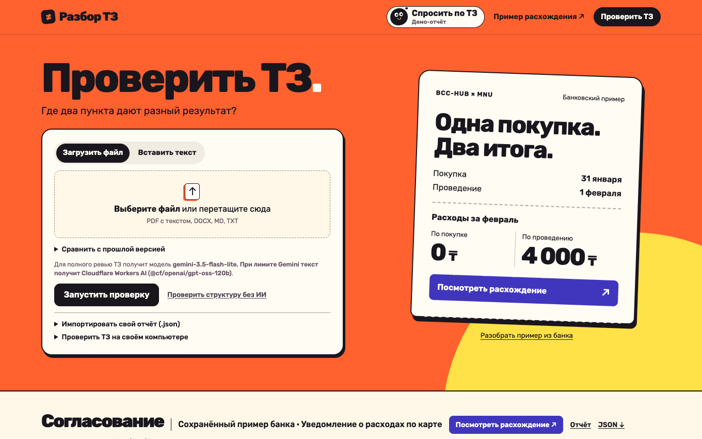
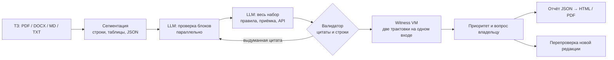

# Разбор ТЗ

**AI-агент проверяет банковское ТЗ до разработки: находит противоречия, доказывает их расчётом и формулирует вопрос тому, кто может принять решение.**

> Покупку сделали 31 января в 23:58, а банк провёл её 1 февраля в 00:03. Сколько прибавить к расходам за февраль? По строке 38 официального ТЗ выходит **0 ₸**, по строке 64 — **4 000 ₸**. Агент показывает обе цитаты, пересчитывает оба исхода на одном примере и спрашивает владельца продукта, какое правило верное.

[Открыть сайт](https://razbor-tz.onrender.com/) · [Отчёт по официальному ТЗ](https://razbor-tz.onrender.com/reports/demo/review.html) · [Питч · PDF](presentation/pitch/razbor-tz-pitch.pdf) · [Демо · 69 с](presentation/bcc-demo.mp4) · [Бизнес-модель](docs/business-model.md) · [Задание BCC-HUB × MNU](https://github.com/BCC-HUB/ai-requirements-validator-task)



## Для жюри: за 2 минуты

| Что проверить | Где это лежит |
| --- | --- |
| Отчёт агента по выданному ТЗ | [PDF](runs/bcc-release/review.pdf) · [HTML](https://razbor-tz.onrender.com/reports/demo/review.html) · [исходный JSON и паспорт](runs/bcc-release/README.md) |
| Запуск одной командой | `python -m reviewer <путь к ТЗ> <путь к отчёту>`, см. [Быстрый старт](#быстрый-старт) |
| Повторить расчёт без ключа и модели | `python -m reviewer.executable replay runs/bcc-release/review.json --source requirements.md` |
| Попробовать без установки | [razbor-tz.onrender.com](https://razbor-tz.onrender.com/): загрузите PDF, DOCX, MD или TXT |
| Архитектура | [Как устроен агент](#как-устроен-агент) · [подробно](docs/architecture-and-evaluation.md) |
| Бизнес-модель и питч | [Бизнес-модель](#бизнес-модель) · [питч, 14 слайдов](presentation/pitch/razbor-tz-pitch.pdf) |

**Соответствие требованиям к репозиторию (§7 ТЗ):** код агента и [`requirements.txt`](requirements.txt) · README с ключом, конфигом, командой и местом отчёта · запуск одной командой с путями входа и выхода · [`.env.example`](.env.example) без ключа, `.env` в `.gitignore` · вход PDF, DOCX, MD, TXT · модель указана в паспорте отчёта.

## Быстрый старт

Нужны Git и Python 3.10+. Команды для macOS и Linux. В Windows создайте окружение через `py -3 -m venv .venv` и активируйте через `.\.venv\Scripts\Activate.ps1`.

**1. Установить.**

```sh
git clone https://github.com/gojosatorukz/bcc-requirements-reviewer.git
cd bcc-requirements-reviewer
python3 -m venv .venv
source .venv/bin/activate
python -m pip install -r requirements.txt
```

**2. Получить ключ LLM.** Создайте бесплатный ключ Gemini в [Google AI Studio](https://aistudio.google.com/apikey). Модель по умолчанию — **Gemini 3.5 Flash-Lite**, бесплатного тарифа достаточно. [Условия Gemini API](https://ai.google.dev/gemini-api/docs/pricing)

**3. Положить ключ.** Скопируйте пример конфига и впишите ключ в строку `GEMINI_API_KEY=`. Агент сам читает `.env`, файл исключён из Git.

```sh
cp .env.example .env
```

**4. Запустить прогон.** Первый путь — файл требований, второй — файл отчёта.

```sh
curl -fL https://raw.githubusercontent.com/BCC-HUB/ai-requirements-validator-task/928c1aa364265426105b69ba7a3444eac11b22db/docs/requirements.md -o requirements.md
python -m reviewer requirements.md output/review.html --workers 1
```

**5. Открыть отчёт.** Он ляжет в `output/review.html`. Формат определяется расширением второго пути: `.html`, `.json` или `.pdf` (для PDF нужен Chrome или Chromium). Флаг `--partial-on-quota` сохраняет частичный отчёт, если закончилась квота Gemini.

Веб-интерфейс на своём компьютере: `python -m reviewer.serve`, затем [127.0.0.1:8765](http://127.0.0.1:8765/). [Docker и другие способы запуска](cloud/container.md)

## Что показал прогон на официальном ТЗ

| Что проверено | Результат |
| --- | --- |
| 198 строк, включая таблицы и JSON | 104 записи в реестре с исходными ID. 5 нарушений, из них 2 критических, и 12 открытых вопросов |
| Покупка на стыке месяцев (Ф-2 и критерий приёмки) | За февраль 0 или 4 000 ₸. На контрольной покупке внутри месяца обе трактовки дают 4 000 ₸ |
| Повторное достижение изменённого порога (Ф-3 и Ф-4) | 1 или 2 push. На контроле обе трактовки дают 1 |
| Четыре ошибочных ответа API | Вопрос владельцу: обязателен ли `result` в каждом ответе. В примерах ошибок есть только `message` |

Отчёт подачи получен на **GPT-6.2 Astra** за 410,60 с, 17 вызовов модели. Тег [`report-v1`](https://github.com/gojosatorukz/bcc-requirements-reviewer/tree/report-v1) указывает на код этого прогона (`67991fe555a3`). Отдельный прогон на бесплатном **Gemini 3.5 Flash-Lite** нашёл оба критических конфликта и вопрос про `result`. [Паспорт и исходный JSON](runs/bcc-release/README.md) · [Сверка 26 контрольных тем](eval/official-coverage/release.md) · [Отчёт и ограничения Gemini](eval/gemini/behavior/README.md)

Повтор вычислений по сохранённому JSON без ключа и новый полный прогон через авторизованный Codex CLI:

```sh
python -m reviewer.executable replay runs/bcc-release/review.json --source requirements.md
REVIEW_PROVIDER=codex REVIEW_MODEL=gpt-6.2-astra python -m reviewer requirements.md output/astra.json --workers 6
```

### Состав отчёта по §6 ТЗ

| Раздел из ТЗ | Где в отчёте |
| --- | --- |
| Паспорт прогона: документ, дата, модель, версия агента | Первая страница и раздел «Паспорт прогона»: коммит, SHA-256 входа, модель, токены |
| Как агент нарезал требования | «Реестр и проверка каждого пункта»: ID в отчёте (R-…), ID в документе (Ф-1…), краткая формулировка и цитата |
| Проверка каждого требования | Там же: оценка по применимым критериям и основание со ссылкой на строку |
| Проверка всего набора | «Качество набора требований»: полнота, согласованность, проверяемость, прослеживаемость, границы решения |
| Сводка | «Сводка · можно ли начинать работу»: число пунктов, нарушений и критических дефектов; «Все замечания · 17» с приоритетом |
| Итог | Там же и в «Что согласовать в первую очередь»: вердикт отдельно для разработки и тестирования, что исправить первым |

## Как устроен агент

Принцип: **LLM рассуждает, код проверяет.** Модель предлагает выводы, а детерминированный код проверяет цитаты и исполняет спорные правила.



1. **Сегментация.** У каждой строки, ячейки таблицы и JSON-примера есть адрес.
2. **Проверка блоков.** Модель параллельно составляет реестр и оценивает каждое требование.
3. **Проверка набора.** Модель сверяет правила, приёмку и API всего документа.
4. **Валидатор.** Код сверяет каждую цитату и номер строки с исходником. Невалидный ответ модели отклоняется и запрашивается заново.
5. **Witness VM.** Две трактовки правила исполняются на одном входе и на контрольном. Разные итоги означают доказанный конфликт.
6. **Вопрос и перепроверка.** Владелец получает вопрос с вариантами исхода. После правки агент проверяет только связанные замечания.

**Модели.** Gemini (по умолчанию, бесплатно), GPT через Codex CLI, Cloudflare Workers AI как резерв. Провайдер и модель задаются в `.env` и записываются в паспорт. Выбранный провайдер получает текст ТЗ.

**Критерии качества** взяты из ISO/IEC/IEEE 29148:2018 (§§ 5.2.5–5.2.6) и IEEE 830-1998 (§ 4.3):

| Объект | Свойства |
| --- | --- |
| Отдельное требование | Однозначность, атомарность, проверяемость, необходимость, осуществимость |
| Набор требований | Полнота, согласованность, осуществимость совокупности |
| Связь с источником | Прослеживаемость: каждая запись и замечание ссылаются на строку |

[Подробное сопоставление критериев с проверками агента](docs/architecture-and-evaluation.md#связь-с-критериями-качества-требований) · [Руководство аналитика](docs/analyst-guide.md)

## Бизнес-модель

| | |
| --- | --- |
| **Пользователь** | Системный аналитик карточного или платёжного продукта, QA и владелец продукта |
| **Покупатель** | Руководитель аналитики или QA направления в банке |
| **Ценность** | Противоречие найдено до первой строки кода. Владелец выбирает один из двух посчитанных исходов, QA получает сценарий с ожидаемым итогом |
| **Тарифы** | Пилот **2,5 млн ₸** (2 недели, 2 команды) → подписка **250 тыс. ₸ в месяц** за команду → лицензия в контуре банка **от 18 млн ₸ в год** со своей моделью |
| **Экономика** | Прогон стоит 25–800 ₸ в зависимости от модели, маржа 60–90%. Одна команда из 20 ТЗ в месяц экономит ≈ 465 тыс. ₸ в месяц, это ≈ 1,9× к подписке |
| **Рынок** | Казахстан ≈ 300 млн ₸ в год (23 банка второго уровня и финтех), цель — 90 млн ₸ ARR за 24 месяца |
| **Цель пилота** | −25% времени до первого принятого вопроса, ≥ 80% согласованных блокеров, ≤ 1 ложного блокера на документ |

Цены и рыночные оценки — гипотезы для пилота, допущения расписаны в документе. [Полная бизнес-модель: canvas, юнит-экономика, рынок, конкуренты, риски, роадмап](docs/business-model.md) · [Ответы на вопросы жюри](presentation/business-brief.md) · [Рынок и первичные источники](research/market/README.md)

## Структура репозитория

| Путь | Что внутри |
| --- | --- |
| [`reviewer/`](reviewer) | Агент: чтение входа, сегментация, провайдеры LLM, валидатор, witness VM, рендер отчёта, веб-интерфейс |
| [`tests/`](tests) | Автотесты: `python -m unittest discover -s tests` |
| [`runs/bcc-release/`](runs/bcc-release) | Официальный отчёт подачи: JSON, HTML, PDF, паспорт, ответы владельца |
| [`eval/`](eval) | Контрольные прогоны на других ТЗ и сверки качества |
| [`docs/`](docs) | Архитектура, руководство аналитика, бизнес-модель |
| [`presentation/`](presentation) | Питч (PDF, PPTX, HTML), демо-видео, сценарий выступления |
| [`research/`](research) | Рынок, пользователь, конкуренты, план пилота |
| [`cloud/`](cloud) | Размещение на Render и запуск в Docker |
