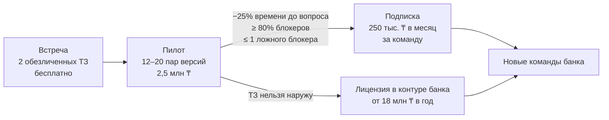
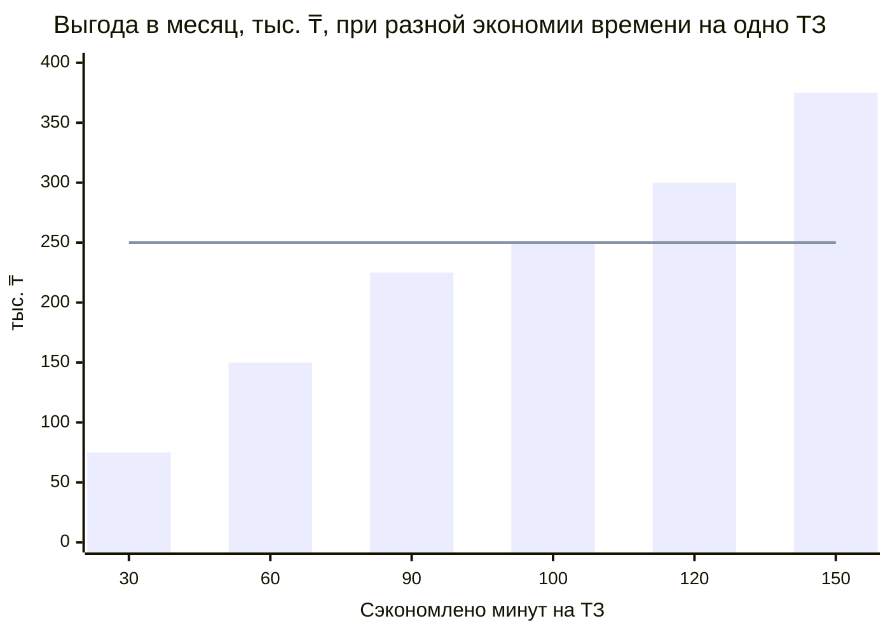

# Бизнес-модель «Разбор ТЗ»

> **Одной строкой.** B2B-сервис для карточных и платёжных команд банков: агент проверяет ТЗ до разработки, доказывает противоречия расчётом на общей операции и передаёт владельцу продукта конкретный вопрос, а QA — ожидаемый результат. Путь к выручке: встреча на двух обезличенных ТЗ → платный пилот → подписка на команду → лицензия в контуре банка.

## За 30 секунд

| Кто платит | За что | Сколько | Когда окупается |
|---|---|---|---|
| Руководитель аналитики или QA карточной команды | Противоречие в ТЗ найдено и посчитано **до** разработки, владелец решает по числам, QA получает ожидаемый итог | Пилот **2,5 млн ₸** → **250 тыс. ₸ в месяц** за команду → лицензия **от 18 млн ₸ в год** | Если агент экономит команде **≥ 100 минут на одно ТЗ** при 20 ТЗ в месяц |

### Карта ценности: боль → что делает агент

| Работа аналитика | Боль сегодня | Что даёт агент | Выигрыш |
|---|---|---|---|
| Свести правило, API и приёмку в одно ТЗ | Расхождение между разделами видно только на тестировании | Находит пары строк, которые дают разный итог на одной операции | Дефект закрыт до первой строки кода |
| Договориться с владельцем продукта | Спор «кто прав» без чисел | Два посчитанных исхода (0 или 4 000 ₸) и контрольный пример | Владелец выбирает за минуту, а не на созвоне |
| Передать задачу QA | Тест пишется по догадке | Сценарий: начальное состояние, действие, ожидаемый итог | Меньше возвратов из тестирования |
| Выпустить исправленную редакцию | Перечитывать документ целиком | Перепроверка только связанных замечаний (30 с на демо-правке) | Ошибочная правка не проходит незамеченной |

### Окупаемость одной команды (20 ТЗ в месяц, 7 500 ₸/ч)

Столбцы — стоимость высвобожденного времени, линия — цена подписки (250 тыс. ₸). Точка безубыточности — 100 минут на ТЗ. Предотвращённые переделки (по 120 тыс. ₸ каждая) идут сверху и в график не включены.

---

**Стадия.** Продуктовый сценарий доказан на официальном ТЗ хакатона. Коммерческая стадия — до первого банковского пилота: интервью с покупателями, согласие банка на пилот, подтверждённая цена и оплаченные договоры пока не получены. Все денежные значения ниже — **модель для проверки в пилоте**. Для каждой цифры указаны допущения, чтобы её можно было пересчитать на данных банка.

---

## 1. Проблема

| Факт | Что он доказывает | Источник |
|---|---|---|
| В официальном ТЗ одна покупка на 4 000 ₸ даёт 0 ₸ по правилу (строка 38) или 4 000 ₸ по приёмочному примеру (строка 64) расходов за февраль | На выданном документе правило и приёмка расходятся на одной операции | [Отчёт агента, D-01](https://razbor-tz.onrender.com/reports/demo/review.html#execution-D-01) |
| В выданном учебном ТЗ 14 пунктов чек-листа ревью оставлены пустыми | Только состояние учебного документа. Проходил ли ручной процесс в BCC, отсюда не следует | [Оригинал организаторов, строки 68–85](https://github.com/BCC-HUB/ai-requirements-validator-task/blob/928c1aa364265426105b69ba7a3444eac11b22db/docs/requirements.md#L68-L85) |
| В исследовании NaPiRE (228 компаний, 10 стран) 44 респондента включили противоречивые требования в пять главных проблем, 109 — неполные или скрытые требования | Проблема отраслевая, а не учебная | [NaPiRE, таблица 9](https://pureadmin.qub.ac.uk/ws/files/90711478/EMSE_D_15_00239_preprint.pdf) |
| Исправлять дефект после выпуска заметно дороже, чем на этапе требований; эффект зависит от масштаба и критичности системы | Ранняя проверка выгоднее. В расчёт ценности множитель не включаем | [Boehm, Basili, 2001](https://www.cs.umd.edu/~basili/publications/journals/J81.pdf) |
| Споры о моменте учёта операции доходят до омбудсмена и регуляторов (Barclays, Lloyds, HSBC) | Иллюстрирует последствия для клиентов. Причину в документации и выгоду продукта эти случаи не измеряют | [research/market/README.md](../research/market/README.md) |

---

## 2. Бизнес-модель на одном листе (Business Model Canvas)

| Блок | Содержание |
|---|---|
| **Стартовый сегмент** | Карточные и платёжные команды банков Казахстана, которые меняют правила расходов, лимитов и уведомлений и передают в разработку связку «правило + API + приёмка». Первая проверенная величина рынка — 23 БВУ на 01.10.2026 (АРРФР). |
| **Роли** | **Пользователь:** системный аналитик (документ, срок, решение о передаче в разработку). **Решает спор:** владелец продукта, у которого есть право принять правило. **Покупатель:** руководитель аналитики или QA с бюджетом. **Допуск данных:** эксперт ИБ, который разрешает режим обработки. |
| **Ценностное предложение** | Противоречие найдено до передачи задачи разработчику и QA. Каждое замечание привязано к строке и цитате. Для поддерживаемых правил конфликт пересчитан на одной операции с контрольным примером. Владелец получает вопрос с вариантами исхода, QA — сценарий с ожидаемым итогом. Новая редакция перепроверяется по связанным замечаниям. |
| **Каналы** | Предлагаем BCC пилот на двух обезличенных ТЗ → референс при согласии банка → прямые продажи руководителям аналитики и QA → профессиональные сообщества аналитиков и QA. |
| **Отношения** | Совместный разбор находок в пилоте, затем сопровождение подписки: настройка критериев под шаблон банка и ежемесячный отчёт о результатах. |
| **Потоки выручки** | Платный пилот с фиксированной ценой · подписка на команду · годовая лицензия в контуре банка и разовое внедрение. |
| **Ключевые ресурсы** | Ядро агента: нарезка с привязкой к строкам, проверка цитат кодом, исполнение двух трактовок правила (witness VM), перепроверка редакций. 261 автоматическая проверка (247 Python и 14 JavaScript). Набор контрольных ТЗ. |
| **Ключевые действия** | Развитие правил и проверок, подключение провайдеров моделей, проведение пилотов и замер результата, внедрение по требованиям ИБ. |
| **Ключевые партнёры** | Провайдеры моделей (сейчас есть адаптеры Codex CLI, Gemini и Cloudflare Workers AI). Будущие партнёры по внедрению — после первого пилота. |
| **Структура затрат** | Команда (основная статья) · вызовы модели · хостинг · поддержка, ИБ и внедрение · длинный цикл продажи в банке. |

---

## 3. Предложение и цены (гипотеза)

| Шаг | Что входит | Цена (гипотеза) | Решение покупателя |
|---|---|---|---|
| **0. Вводная встреча** | 2 обезличенных ТЗ с правками, разбор вопросов агента с аналитиком | Без оплаты | Выделить ревьюеров и согласовать объём пилота |
| **1. Пилот** | 2 недели, 2 команды, 12–20 пар версий ТЗ, настройка критериев, совместный разбор, отчёт о результатах | **2,5 млн ₸** фиксированно, это **≈ 125–208 тыс. ₸ за пару версий** | По критериям §9 решить о следующем оплачиваемом этапе |
| **2. Команда (SaaS)** | До 10 пользователей, до 100 прогонов в месяц, веб-интерфейс, PDF, экспорт задач в Jira через CSV, поддержка | **250 тыс. ₸ в месяц** за команду | Для команд, которым ИБ разрешает внешнюю обработку |
| **3. Банк (контур банка)** | Развёртывание у банка, модель по выбору банка, безлимит команд, шаблоны и чек-листы банка. SSO и готовая поставка — в планах | **от 18 млн ₸ в год** + внедрение **от 5 млн ₸** | Для банков, где ТЗ нельзя передавать наружу |

Цены и готовность платить проверяются на переговорах. Пилот стоит столько же, сколько 10 месяцев одной подписки, поэтому его ценность — в замере на своих документах, а не в объёме прогонов.

---

## 4. Юнит-экономика

### Стоимость модели на один прогон

| Профиль | Токены | Допущение о цене | Стоимость |
|---|---|---|---|
| Официальный прогон Astra (`runs/bcc-jury`) | 334 393 входных (11 264 из кэша) + 34 988 выходных = 369 381 | Условно $0,10 / $0,40 и $3 / $15 за 1 млн, без скидки за кэш, 520 ₸/$ | **24,67–794,56 ₸** |
| Сохранённый прогон Gemini 3.5 Flash-Lite | 96 609 входных (22 964 из кэша) + 47 934 выходных | Опубликованные платные ставки $0,30 / $2,50 и $0,03 за кэшированный вход, 520 ₸/$ | **74,16 ₸** (без скидки за кэш 77,39 ₸) |

Официальный прогон выполнен через подписку Codex, фактический платёж по API за него не измерялся. Хранение, повторы и работа оператора считаются отдельно. [Тарифы Google](https://aistudio.google.com/docs/pricing#gemini-3.5-flash-lite)

### Остаток после модели и хостинга (тариф «Команда»)

100 прогонов + 25 000 ₸ инфраструктуры при выручке 250 000 ₸ дают **58,2–89,0% остатка** в диапазоне цен из таблицы выше. До валовой маржи коммерческого пилота ещё вычитаются прямые часы поддержки, сопровождения, ИБ и внедрения. Для поставки в контур банка отдельно учитываются поддерживаемые окружения и вычисления у заказчика.

### Ценность для банка: порог окупаемости одной команды

| Допущение | Значение |
|---|---|
| ТЗ на ревью в месяц | 20 |
| Стоимость часа аналитика / QA | 7 500 ₸, что соответствует ФОТ ≈ 1,26 млн ₸ в месяц с налогами ÷ 168 ч |
| Цена подписки | 250 000 ₸ в месяц |

**Порог окупаемости только по времени:** 250 000 ₸ ÷ 7 500 ₸ = 33,3 ч в месяц, это **100 минут сэкономленного труда на одно ТЗ**.

**Сценарий:** 1,5 ч экономии на ТЗ (20 × 1,5 × 7 500 = 225 000 ₸) и 2 предотвращённые переделки по 16 ч (240 000 ₸). Выгода 465 000 ₸, чистый эффект 215 000 ₸, **выгода к цене 1,86×, чистый ROI 86%**. Обе статьи должны относиться к разным часам.

**Чувствительность:** при ФОТ 1 млн ₸ (5 952 ₸/ч) и том же объёме чистый ROI **47,6%**. Если предотвращённых переделок нет, при ставке 7 500 ₸ эффект **−25 000 ₸, ROI −10%**. Цифры моделируют стоимость высвобожденного рабочего времени и проверяются замером в пилоте (§9).

---

## 5. Рынок (сценарная оценка снизу вверх)

| Уровень | Логика | Оценка в год |
|---|---|---|
| **Проверенная величина** | 23 БВУ в Казахстане на 01.10.2026 | [АРРФР](https://www.gov.kz/org/ardfm/press/news/details/1321809?lang=ru) |
| **Банки (сценарий)** | Гипотеза: у ~12 банков своя разработка, в среднем 5 продуктовых команд пишут ТЗ → 60 команд × 3 млн ₸ подписки | **≈ 180 млн ₸** |
| **Финтех, страхование, подрядчики (сценарий)** | Ещё ~40 команд по той же цене | **≈ 120 млн ₸** |
| **Цель через 24 месяца** | 2 банка на SaaS по 5 команд (30 млн) + 1 банк в контуре (18 млн) + 4 финтех-команды (12 млн) | **≈ 60 млн ₸ ARR** |

Число команд и готовность платить — гипотезы, подтверждённой воронки пока нет. Банку с 10 и более командами выгоднее лицензия в контуре (от 18 млн ₸ в год плюс внедрение и собственная эксплуатация), чем SaaS за 30 млн ₸ в год. Поэтому для крупных банков основной продукт — лицензия, а SaaS — для финтеха и небольших банков.

---

## 6. Альтернативы и наше отличие

| Альтернатива | Что делает | Где наш сценарий другой |
|---|---|---|
| Ручное ревью по чек-листу | Опыт аналитика | Агент даёт пересчёт двух трактовок на одной операции и контрольный пример |
| Общий чат с моделью | При нужном запросе может процитировать строку | Не исполняет два правила на одном входе и не перепроверяет редакцию по связанным замечаниям |
| QVscribe | Сравнивает похожие требования в наборе | Очного сравнения на этом ТЗ мы не проводили. В пилоте сравним с одиночным запросом к модели |
| IBM Engineering AI Hub | Генерирует черновые тесты по требованиям | Агент формирует вопрос владельцу до того, как выбран ожидаемый результат теста |

**Наш доказанный сценарий:** две русские цитаты, воспроизводимый результат на общей операции (0 или 4 000 ₸), контрольный пример, свободный ответ владельца и перепроверка новой редакции, на которой ошибочная правка оставила замечание открытым. [QVscribe](https://qracorp.com/faqs/) · [IBM Engineering AI Hub](https://www.ibm.com/new/announcements/ibm-engineering-ai-hub-1-4-expands-ai-assisted-engineering)

---

## 7. Выход на рынок

1. **Декабрь 2026.** Предлагаем BCC пилот на двух обезличенных ТЗ. Сотрудничество и референс требуют согласия банка.
2. **I кв. 2027.** Экспорт задач в Jira через CSV уже есть. Нативные Jira и Confluence, загрузка шаблона и чек-листа банка — с условием приёмки на пилоте.
3. **II кв. 2027.** Поставка в контур банка и SSO после согласования требований ИБ, модель по выбору банка.
4. **II полугодие 2027.** Новые банки и финтех-команды при подтверждённом спросе.

---

## 8. Риски и ответы

| Риск | Ответ |
|---|---|
| ТЗ нельзя отправлять во внешний сервис | Поставка в контур банка — план после согласования ИБ. Провайдер модели задаётся в конфигурации |
| Ложные тревоги раздражают аналитиков | Конфликт подтверждается расчётом двух исходов. Цель пилота — не больше 1 ложного блокера на документ |
| Совпадение цитаты не доказывает верность трактовки | Трактовку подтверждает владелец продукта, агент только показывает исходы |
| Длинный цикл продажи в банке | Бесплатная встреча, затем пилот с фиксированной ценой и понятными критериями |
| Зависимость от одного провайдера | Уже есть адаптеры Codex CLI, Gemini и Cloudflare. При исчерпании квоты агент выдаёт частичный отчёт |
| Реальная экономия неизвестна | Пилот измеряет время и ложные тревоги против ручного ревью и одиночного запроса к модели |

---

## 9. Как проверяем пользу в пилоте

**Дизайн.** На парных обезличенных ТЗ сравниваем три режима: ручное ревью, одиночный запрос к той же модели и агента. Документы и роли чередуем. Два банковских эксперта заранее согласуют блокеры. Вопросы оцениваются вслепую, без указания режима.

| Метрика | Определение | Цель |
|---|---|---|
| Время до первого принятого вопроса | Медиана активных минут аналитика | −25% к ручному ревью |
| Суммарные активные часы ревью | С учётом перепроверки редакции; используется для ROI | Замер, цель задаётся после пилота |
| Найденные блокеры | Доля блокеров, согласованных двумя экспертами; публикуем числитель и знаменатель | ≥ 80% |
| Ложные блокеры и ошибочные закрытия | На документ и на контрольных правках | ≤ 1 ложного блокера, 0 ошибочных закрытий |

**Решение о продолжении.** Успешный результат пилота и готовность оплачивать следующий этап фиксируются письменно и раздельно. Если пороги достигнуты, покупатель выбирает объём следующего оплачиваемого этапа. Если нет, записываем причину: качество, ограничения по данным или цена.

Протокол пилота: [research/market/organizers-and-pilot.md](../research/market/organizers-and-pilot.md) · ответы на вопросы жюри: [presentation/business-brief.md](../presentation/business-brief.md).
